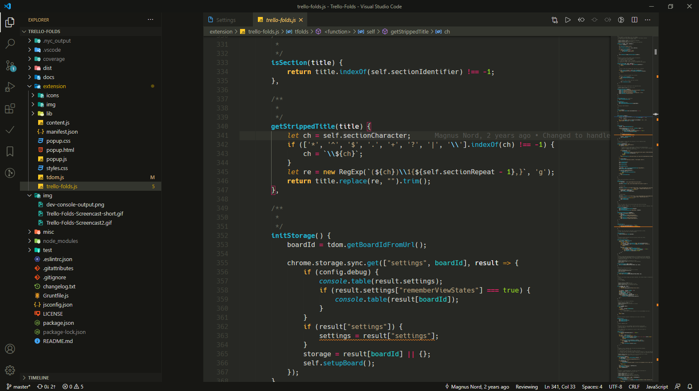
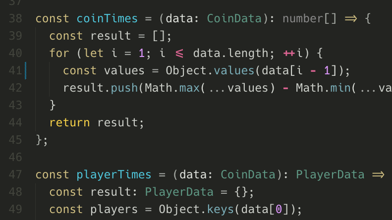
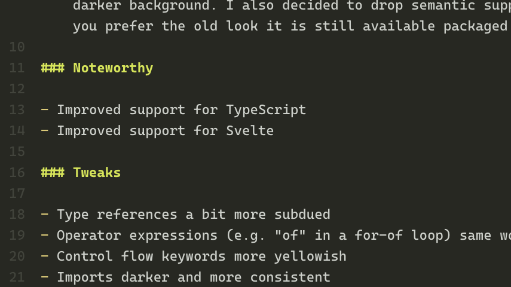

# AGNIS Theme

AGNIS — **A Gloomy Night In Sweden** — is a moody dark VS Code theme with muted neutrals, warm earth tones, cool Nordic accents, and a deliberately low-glare UI.

It ships with two variants:

- **AGNIS** — the current theme with expanded semantic and language support
- **AGNIS Legacy** — the earlier look, kept around for anyone who prefers the old direction



## Why AGNIS

AGNIS aims to feel calm, readable, and a little autumnal rather than loud or neon. Recent work has focused on:

- improved UI contrast and keyboard focus visibility
- broader language coverage and semantic highlighting
- cleaner palette consistency across syntax and workbench colors

I mainly test the theme on languages I use myself:

- JavaScript / TypeScript
- CSS
- JSX / TSX
- Svelte
- Markdown
- HTML

If you spot something odd in another language, please open an issue.

## Installation

1. Install [Visual Studio Code](https://code.visualstudio.com/)
2. Open the **Extensions** view
3. Search for `AGNIS`
4. Click **Install**
5. Open **Preferences: Color Theme**
6. Select **AGNIS** or **AGNIS Legacy**

## Feedback and issues

Found something weird? Please open an issue and, if possible, include:

- a screenshot
- the language or file type
- the scope/token details if you inspected them

- Issues: [github.com/NordMagnus/AGNIS/issues](https://github.com/NordMagnus/AGNIS/issues)
- Repository: [github.com/NordMagnus/AGNIS](https://github.com/NordMagnus/AGNIS)

## Bracket pair highlighting

Bracket pair highlighting is intentionally toned down. If you want stronger bracket colors, you can override them in your own settings:

```json
{
  "editor.bracketPairColorization.enabled": true,
  "workbench.colorCustomizations": {
    "editorBracketHighlight.foreground1": "#CDD0CA",
    "editorBracketHighlight.foreground2": "#CDD0CA",
    "editorBracketHighlight.foreground3": "#CDD0CA",
    "editorBracketHighlight.foreground4": "#d4e448",
    "editorBracketHighlight.foreground5": "#f6d256",
    "editorBracketHighlight.foreground6": "#df99ff",
    "editorBracketHighlight.unexpectedBracket.foreground": "#ff0000"
  }
}
```

## Screenshots

### TypeScript with Hack Mono



### Markdown with Cascadia Code



## Changelog

See [CHANGELOG.md](./CHANGELOG.md) for release history.
